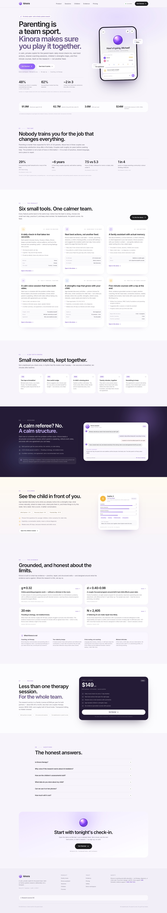
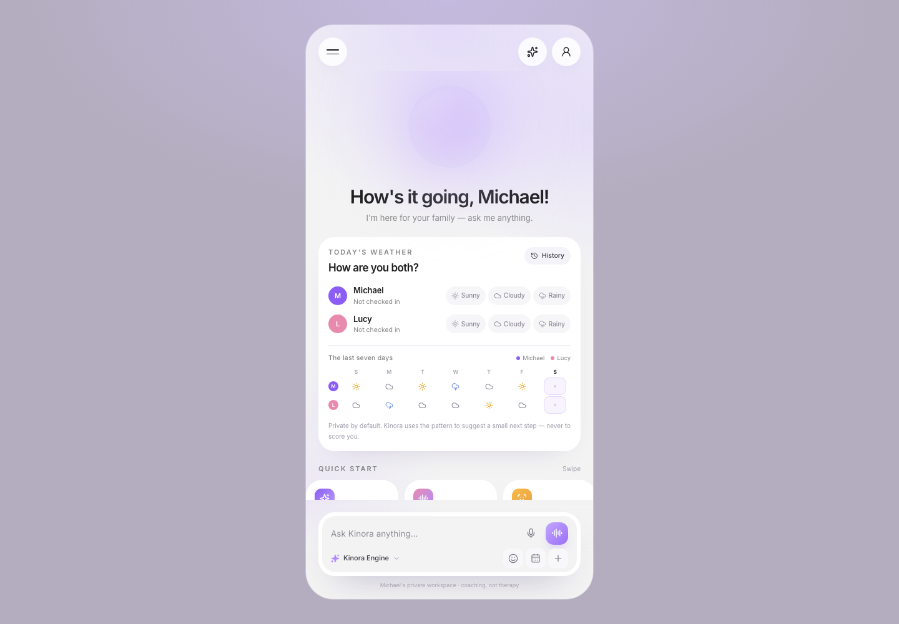
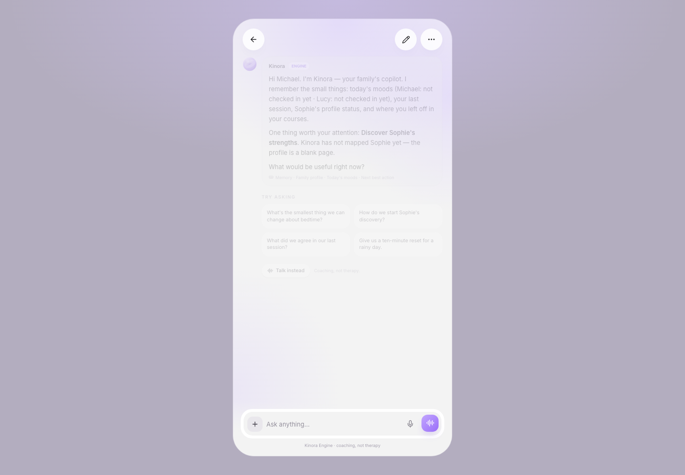
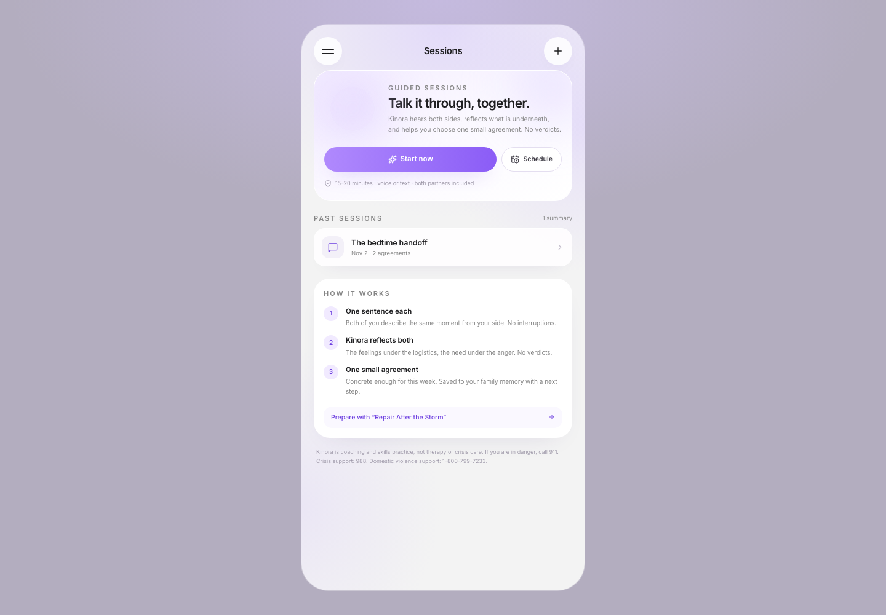
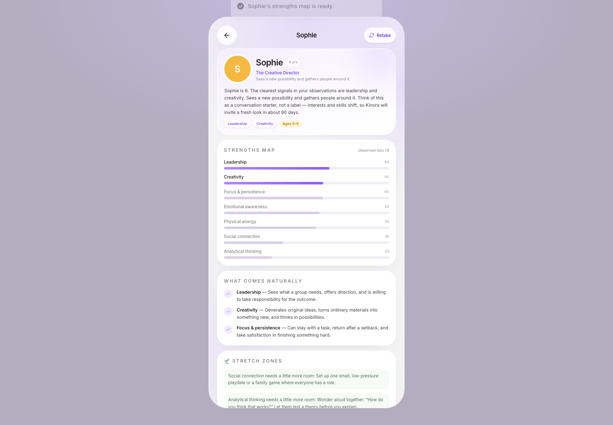
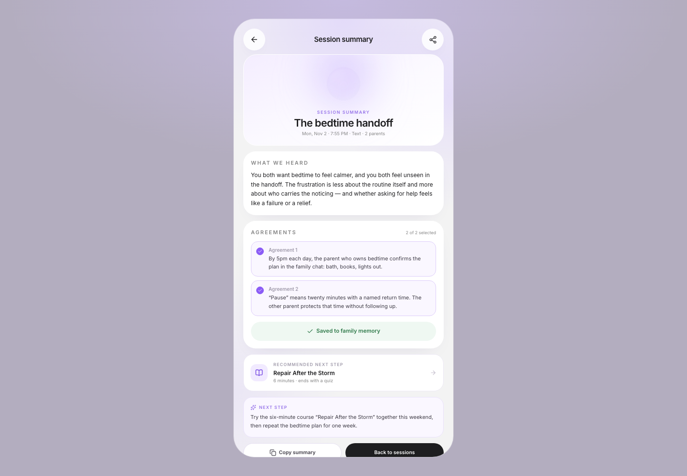
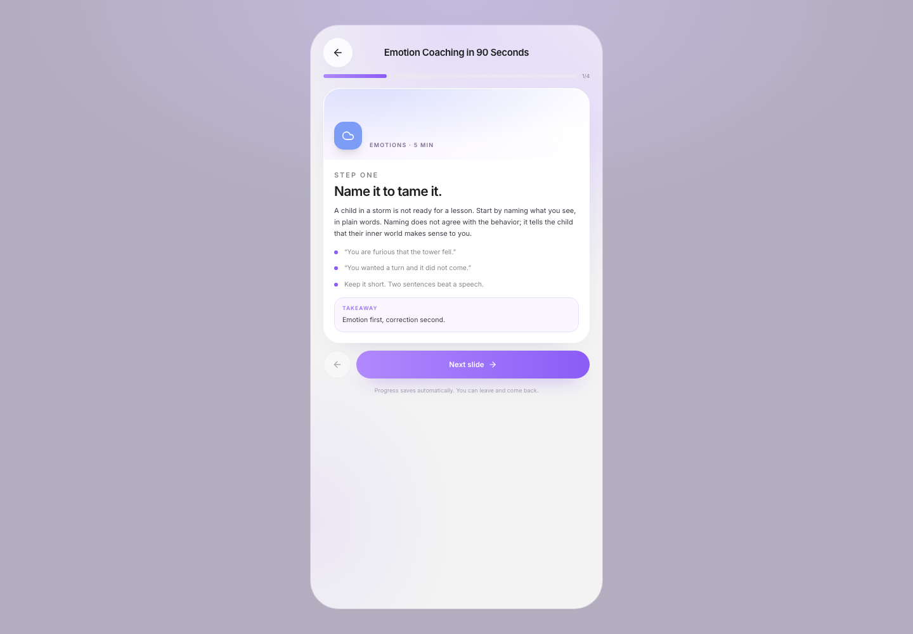

# Kinora — the family copilot

> **Parenting is a team sport. Kinora makes sure you play it together.**

Kinora is a working, end-to-end family copilot for the parent team: daily mood check-ins, next best actions, a context-aware family assistant, structured coaching sessions with a voice-first room, age-banded children's strengths maps, and five-minute courses.

The app is built for the demo family **Michael & Lucy Bennett** and their daughter **Sophie (6)**. There is intentionally no "create family" or "invite" flow — the family is seeded, as requested. "Get Started" opens the workspace immediately.

## Pitch deck

- [Editable seed deck (PPTX)](pitch-deck/kinora-seed-2026.pptx) — 10 focused slides, editable in PowerPoint, Keynote, or Google Slides.
- [PDF export](pitch-deck/kinora-seed-2026.pdf) — the same 10 slides, print-ready.
- [Speaker notes + VC Q&A](pitch-deck/SPEAKER-NOTES.md) — a five-minute script and the questions a partner will ask.
- [Long-form HTML deck](pitch-deck/index.html) — the 18-slide design source and diligence appendix.
- [Long-form PDF](pitch-deck/kinora-seed-2026-long.pdf) — the 18-slide archive.
- [Deck README](pitch-deck/README.md) — design system, screenshot capture, and rebuild commands.

The visual language follows `reference_design.webp`: lavender canvas, soft `#F3F3F3` surfaces, white cards, the purple Kinora orb, and iOS-like pill controls. The orb is a real animated WebGL shader with an SVG fallback.

| Landing | Family home |
| --- | --- |
|  |  |

| Assistant | Sessions |
| --- | --- |
|  |  |

| Child strengths | Session summary | Course |
| --- | --- | --- |
|  |  |  |

---

## The two-minute demo

1. Open `/` and read the research-backed story. **Get Started** opens the app as Michael.
2. On **Home**, tap **Sunny** for Michael and **Cloudy** for Lucy. The 7-day timeline updates, and the suggested next steps recalculate from real family state.
3. Tap **Ask Kinora** → ask *"What did we agree in our last session?"* Kinora answers with the saved bedtime agreement.
4. Open **Sessions** → **Start now** → choose a starter problem → **Text** → **Start now**. Michael describes the bedtime handoff, Kinora invites Lucy, Lucy answers, and Kinora reflects the need under the frustration.
5. Tap **End** → **End and reflect**. Review the neutral summary, save the two agreements, and open the recommended course.
6. Open **Children** → **Sophie** → **Start the discovery**. Answer ten picture-first questions; the profile becomes *The Creative Director* with strengths, stretch zones, interests, career seeds, and things to try. Reload — it persists.
7. Open **Courses** → *Emotion Coaching in 90 Seconds* → four slides → the three-question quiz. Pass (2/3) and the completion is saved; fail and you can review every answer and retry.

Everything above is a real interaction backed by the server store. There are no dead buttons in the main flow.

---

## What is implemented

### 1. Landing page (`/`)

- Research-based hero with the 48%/26%, 62%, and ~2 in 3 statistics, plus source labels.
- Use-case cards for all six modules, each with a mini UI preview and a link into the demo.
- "A day with Kinora" timeline, a session mock, an illustrative children's profile, evidence cards, "What Kinora is not" safety cards, a $149 Family License anchor, FAQ, and a full source list.
- Responsive from 430px to desktop. On desktop the app itself is a centered device shell, matching the reference.
- Every number traces to the research folder; no invented testimonials or child outcomes.

### 2. Family home (`/app`)

- **Moods**: Michael and Lucy each choose **Sunny / Cloudy / Rainy** once per day. The choice is editable and persists, with a clean 7-day timeline for both parents.
- **Next best actions**: a transparent rule engine uses today's moods, the last session, stale/missing child profiles, course progress, and upcoming sessions. Every action deep-links to the page that does the work. Priority order includes:
  - rainy-day reset for each parent,
  - a team check-in when both parents are low,
  - a child discovery when the profile is missing or older than 90 days,
  - continue an in-progress course,
  - prepare for an upcoming session or book one after a 7-day gap,
  - "bank the good day" when both parents are sunny.
- **Quick actions** to the assistant, sessions, the first child, and courses.
- The home surface is deliberately focused: greeting, mood check-in, quick actions, and today's suggested next steps.

### 3. Individual assistant (`/app/assistant`)

- Context-aware replies built from real state: today's moods, 7-day mood history, child profiles, the latest session and agreements, and course progress.
- Answers stay grounded in real family state without exposing model names, token counts, or developer labels.
- **Anti-triangulation**: one-sided venting about a partner is acknowledged, then redirected to a two-sided session instead of being validated into a "who is right" answer.
- **Safety routing**: crisis and abuse language stops coaching and surfaces 988, 911, and the DV hotline.
- A live thinking state, copy / regenerate / share / save-for-later actions, new conversation, transcript copy, and persistent threads.
- **Voice input sheet** using the Web Speech API, with a text fallback when the browser does not support it.
- The **Kinora Engine** answers deterministically by default; the same interface can call AI SDK 7 when an LLM is configured.

### 4. Psychologist sessions (`/app/sessions`, `/app/sessions/new`, `/app/sessions/[id]`)

- Start immediately or schedule with the problem written down.
- Voice or text mode; both partners are included.
- Kinora leads a structured, evidence-informed arc: **story → emotion → needs → common ground → agreement → close**. It alternates speakers, references what was just said, and never declares a winner.
- One phone sits between the parents. The deployed `kinora-agent` listens to the shared microphone, uses speaker diarization to tell Michael and Lucy apart, highlights the detected parent, and tags the transcript. The parent buttons are a manual correction, not the primary signal.
- Voice mode opens the shared-phone LiveKit meeting automatically. The deployed `kinora-agent` handles STT, the Ollama turn, and Cartesia speech, then posts final captions back into the session. If LiveKit is unavailable, the room shows an honest retry state and the text composer remains usable.
- A written summary includes **what we heard** (with both parents' quotes), **two agreements**, and a **recommended course**. Agreements can be saved to family memory.
- A 20-minute pause and repair framing comes from the flooding/repair research; the session is explicitly **coaching, not therapy or mediation**.
- Crisis/abuse language pauses the session and shows the real resources instead of continuing.

### 5. Children (`/app/children`, `/app/children/[id]`, `/discover`)

- Add a child with a first name, birth date, and avatar color. Minimal data, no child accounts.
- The first visit is deliberately a blank page: *"Kinora doesn't know Sophie yet."*
- Three age bands:
  - **Little Explorer** (2–5): six picture-first questions,
  - **Discovery Quest** (6–9): ten everyday scenarios,
  - **Potential Map** (10–13): twelve Likert-style statements.
- Seven traits: creativity, analytical thinking, social connection, emotional awareness, physical energy, focus & persistence, leadership.
- Results include an archetype, strengths, stretch zones, interests, career seeds, three parenting tips, three activities to try, and a 90-day refresh date. The profile is explicitly **not a diagnosis**, and the UI says so on the landing page, at intake, and on the result.
- Assessment history is kept, and the profile persists across reloads.

### 6. Courses (`/app/courses`, `/app/courses/[slug]`)

- Six short, research-informed courses: repair, emotion coaching, the fair-load reset, connection missions by age, the weekly team huddle, and screens/boundaries.
- Each course has four slides, a takeaway, and a three-question quiz. Two of three passes.
- Progress saves automatically; completion is persisted; a failed quiz shows the correct answers and explanations and can be retried.
- Courses are linked from the home, the assistant, the session summary, and the menu.

### 7. Design system

- Extracted from the reference: canvas `#B3ADBF`, surface `#F3F3F3`, ink `#1E1E20`, muted `#858585`, border `#E4E2E8`, purple `#D6C7FE → #8B5CF6`, sunny `#F5B942`, rainy `#7C9CF5`.
- Inter with tight display tracking, 22–28px cards, soft purple-tinted shadows, and pill controls.
- The **Kinora orb** is a custom WebGL fragment shader (swirling ribbons, glass sphere, glow) with a crisp SVG fallback and a reduced-motion path.
- Mobile full-bleed; desktop 460px device shell on the lavender canvas. Landing page is responsive and uses the same visual language without generic dashboard chrome.
- Accessibility: semantic headings, labelled controls, `aria-pressed` mood and answer buttons, focus rings, reduced-motion support, and accessible names on icon-only buttons.

---

## Stack

- **Next.js 16.4** App Router, React 19.3, TypeScript
- **Tailwind CSS 4.3** with extracted design tokens
- **shadcn/ui** (Nova preset) + **AI Elements** (Conversation, Message, MessageResponse, actions)
- **AI SDK 7** (`ai`, `@ai-sdk/react`, `@ai-sdk/openai-compatible`) for the optional LLM path, pointed at **Ollama Cloud** (`gemma4:31b`)
- **Supabase** JS + `@supabase/ssr` helpers (server/client/session refresh) + migration for the hosted JSONB backend
- **LiveKit** server SDK for scoped room tokens and agent dispatch, client SDK for the two-phone room, and a Python **LiveKit Agents 1.8** worker for the deployed voice agent
- **Vitest** + Testing Library for unit/component tests
- **Playwright** for end-to-end and visual smoke tests
- **Docker** multi-stage standalone image + Compose, plus an agent image

---

## Architecture

```
src/
  app/
    page.tsx                 landing
    app/                     demo workspace (seeded family)
      page.tsx               home: moods, next actions, snapshot, composer
      assistant/page.tsx     memory-aware assistant
      sessions/page.tsx      list + start/schedule sheet
      sessions/[id]/page.tsx room | scheduled | summary | safety
      children/page.tsx      children list + add sheet
      children/[id]/page.tsx unknown state | strengths map
      children/[id]/discover two-minute to three-minute assessment
      courses/page.tsx       catalog + filters
      courses/[slug]/page.tsx slides + quiz + review
    api/
      state, mood, children, children/[id]/assessment,
      sessions, sessions/[id], sessions/[id]/turn,
      sessions/[id]/transcript,
      assistant, assistant/flag, courses/[slug],
      settings, livekit/token, livekit/dispatch,
      supabase/health, health, test/reset
  components/
    brand/                   orb shader, SVG mark, wordmark
    app/                     shell, header, sheets, home modules
    assistant/               chat, voice input
    sessions/                list, room, summary, scheduled, safety
    children/                add child
    ai-elements/             vendored AI Elements registry components
    ui/                      vendored shadcn/ui components
  content/
    landing.ts               research-backed landing content
    courses.ts               six courses
    assessments.ts           age bands, scoring seeds, archetypes
  lib/
    engine/                  Kinora Engine, psychologist, child profile,
                             memory, actions, safety, LLM adapter, grading,
                             psychologist-service (LLM polish outside the lock)
    store/                   Store interface, FileStore, SupabaseStore, seed
    date.ts, types.ts, utils.ts, livekit.ts, api-utils.ts, rate-limit.ts
  utils/supabase/            server, client, and session-refresh helpers
  proxy.ts                   Next 16 proxy: global API limit + auth refresh
  hooks/
    use-speech.ts            Web Speech dictation for text mode
    use-livekit.ts           room join, dispatch, participants, captions,
                             speaker-select data packets
agents/kinora-voice/         LiveKit Agents Python worker + Dockerfile + tests
supabase/migrations/0001_kinora_state.sql
e2e/                         Playwright specs
tests/unit/                  Vitest specs
docs/superpowers/specs/      product + technical design
```

### Data flow

- The app layout fetches a `FamilyState` snapshot on the server and passes it to a client `FamilyProvider`.
- Mutations go through typed API routes, which validate with Zod and run through a serialized repository (`read → mutate → atomic write`).
- The provider applies the returned state, so the UI is always showing persisted state. Sessions poll while active so the shared phone stays in sync.
- The default backend is a JSON file at `.data/kinora.json` (or `KINORA_DATA_DIR`). It is atomic and safe for a single instance. Supabase can replace it without changing API routes.

### Seeded state

- Family: **The Bennett Family**, Michael & Lucy.
- Child: **Sophie, 6** — deliberately unmapped until you run the first discovery.
- One completed session: **The bedtime handoff**, with two saved agreements.
- Mood history for the last six days; today starts empty so the check-in is real.
- One course in progress: **Repair After the Storm**, slide 2 of 4.
- The seed is deterministic relative to the current date, so every demo starts in a useful state.

---

## The Kinora Engine and the optional LLM

The default `KINORA_AI_MODE=engine` uses a deterministic, context-aware engine:

- The assistant routes intents (mood, child, session, course, conflict, plan) and writes answers from real state with grounded family context. It has no network dependency and cannot be slow or unavailable.
- The psychologist is a small state machine with a phase-aware coaching arc, speaker tracking, domain-specific reflections/agreements, and a neutral summary.
- Safety screening runs before coaching in both surfaces.

To use an LLM via **AI SDK 7**, point it at **Ollama Cloud** (OpenAI-compatible):

```bash
# .env.local
KINORA_AI_MODE=llm          # or "auto" to try the LLM and fall back
KINORA_LLM_BASE_URL=https://ollama.com/v1
KINORA_LLM_MODEL=gemma4:31b
KINORA_LLM_API_KEY=...      # Ollama Cloud key; never commit it
KINORA_LLM_TIMEOUT_MS=30000
```

`gemma4:31b` is lightweight enough for fast turn-by-turn replies and multilingual enough for mixed-language families. The same key can be supplied to the Python agent as `KINORA_LLM_API_KEY`; the agent uses `livekit-plugins-openai` against the same endpoint. Any other OpenAI-compatible endpoint works too. No LangChain layer is needed: AI SDK 7 is the app path and the LiveKit OpenAI plugin is the voice path, both speaking the same OpenAI Chat Completions contract.

The assistant service falls back to the Kinora Engine on a missing key, timeout, or provider error, so the UI never breaks. The deterministic engine is the tested default; the LLM path uses a strict system prompt with the same safety, both-sides, and no-diagnosis rules. Session turns use the same two-phase pattern: append the parent's turn under the store lock, call the LLM outside the lock, then append Kinora's reply. A slow model never holds the repository lock.

---

## Voice sessions and LiveKit

A voice session runs on **one phone placed between the parents**. Both parents speak into the same microphone in turns. There is no robotic device-voice fallback and no second phone to join.

### The one-phone voice-agent path

- **Join**: a voice session auto-connects as the shared `family_phone` identity. The token route issues a scoped 2-hour token (`roomJoin`, `canPublish`, `canSubscribe`, `canPublishData`). Per-parent identities are still accepted for operator and debug use.
- **Dispatch**: after the shared phone connects, the browser calls `/api/livekit/dispatch`. The route loads the session by room name, creates the room if needed, and sends an explicit dispatch to the `kinora-agent` worker with session metadata: title, problem, opening line, parent names, and who has the floor first. A finished dispatch is not treated as active, so re-joining a room starts a fresh agent job.
- **Agent**: `agents/kinora-voice/` is a LiveKit Agents 1.8 Python worker. `RoomIO` links to the shared phone, AssemblyAI (`assemblyai/universal-3-6-pro`) transcribes with **speaker diarization** (`speaker_labels`), **Ollama Cloud `gemma4:31b`** writes the next turn, and **Cartesia Sonic 3** speaks it in a female voice. The agent is instructed to use only the seeded parent names, keep the evidence-informed arc, never decide who is right, and stop coaching for safety.
- **Speaker detection**: the first voice after the opening maps to the parent Kinora invited first; the next new voice maps to the other parent. The agent tags the user turn as `[Name is speaking]` and publishes `kinora.speaker_detected` over the data channel so the phone highlights the right parent and labels the transcript. Tapping **Michael** or **Lucy** is a manual correction for the current voice.
- **Captions back to the app**: the browser receives LiveKit transcriptions for both sides and posts final segments to `/api/sessions/[id]/transcript`. Those become real session turns, so memory, the summary, and saved agreements still work. The opening is de-duplicated.
- **Audio unlock**: the room unlocks WebAudio from the join tap and exposes **Tap to enable sound** if a mobile browser pauses playback. The agent audio element is `playsinline`, and attached tracks are unmuted when the room says audio is allowed.
- **End**: the agent stays while the shared phone remains, then shuts down after the room has been empty for two minutes. A parent can leave the room and keep the text room fully usable.
- **No fallback voice**: if LiveKit, the agent, or the microphone is unavailable, the session stays usable as text. It never switches to a browser system voice.

### Local and cloud

The worker can run locally or on LiveKit Cloud:

```bash
cd agents/kinora-voice
uv sync
uv run src/kinora_agent.py dev      # local worker, hot reload
```

Cloud deployment (already exercised in this project):

```bash
brew install livekit-cli
lk project add kinora --url wss://<project>.livekit.cloud --api-key ... --api-secret ...
lk agent create --region eu-central --secrets-file /tmp/kinora-agent-secrets.env
lk agent deploy --id <agent-id> --deployment production \
  --secrets-file /tmp/kinora-agent-secrets.env
```

`KINORA_AGENT_DEPLOYMENT` is intentionally **empty** for the hosted default worker. Set it to `kinora-dev` only when you are running a local worker under that deployment. `KINORA_AGENT_NAME` defaults to `kinora-agent` and must match both the agent's `rtc_session(agent_name=...)` and the dispatch route.

The cloud agent runs in **eu-central**. Cartesia Sonic 3 has an EU endpoint; Fish Audio does not, which is why the TTS default is Cartesia. STT (`assemblyai/universal-3-6-pro`) also has an EU endpoint. Agent secrets are stored in LiveKit Cloud, not in the repo.

### Graceful limits

If LiveKit, the agent, or the microphone is unavailable, the UI says so and the session stays usable in text mode. The token and dispatch routes are rate-limited; the agent waits up to 60 seconds for the shared phone before speaking the opening, so an early dispatch does not waste the opening on an empty room. The voice card reports a dispatch timeout after 20 seconds and offers **Ask Kinora to join again**.

This is deliberately a **turn-based** voice experience, not an always-on third voice during a fight. The research warns that flooded people cannot process a third voice mid-conflict; Kinora is used when calm or scheduled for later, and it recommends a pause when either partner is flooded.

---

## Rate limits and token protection

Expensive paths are protected per client IP with a sliding-window limiter in `src/lib/rate-limit.ts` and a global API guard in `src/proxy.ts` (Next 16's renamed middleware):

| Bucket | Limit |
| --- | --- |
| Assistant (`/api/assistant`) | 15/min, 200/day |
| Session turn (`/api/sessions/[id]/turn`) | 40/min, 600/day |
| LiveKit token | 8/min, 80/day |
| LiveKit dispatch | 6/min |
| Session create | 20/min, 200/day |
| Child assessment | 10/min, 100/day |
| Voice transcript sync | 120/min |
| All API routes | 600/min |

A denied request returns HTTP `429` with `Retry-After`, `X-RateLimit-Limit`, and `X-RateLimit-Remaining`, and the UI/provider surfaces the error. IP resolution uses the first `x-forwarded-for` hop, then `x-real-ip`, then `cf-connecting-ip`.

The limiter is in-memory, which is correct for the single-process demo and local Docker. On Vercel or any multi-instance deployment, replace the `Map` with Redis/Upstash behind the same `RateLimiter.check()` interface; otherwise each instance keeps its own counters. The limits are deliberately conservative: a normal two-parent session will not hit them, while a loop cannot burn the model or voice budget quickly.

---

## Supabase

The app runs with **no database setup** using the file store. Supabase is wired end to end, but the demo table must be created once with a key that can run DDL:

1. Open the Supabase SQL editor and run `supabase/migrations/0001_kinora_state.sql` (or use `supabase db push` with a secret/DB URL). The provided **publishable key cannot run DDL**.
2. Set:
   ```bash
   DATA_BACKEND=supabase
   NEXT_PUBLIC_SUPABASE_URL=https://jnmabxgqxfactdvgzinz.supabase.co
   NEXT_PUBLIC_SUPABASE_PUBLISHABLE_KEY=sb_publishable_...
   # optional: SUPABASE_SERVICE_ROLE_KEY=...
   ```
3. Restart. The `SupabaseStore` reads/writes the single `bennett-demo` JSONB row. `/api/supabase/health` reports `{ configured, tableReady, table, error, hint }`; `/api/health` reports the active storage backend.

`@supabase/ssr` is installed with the official helpers:

- `src/utils/supabase/server.ts` — request-scoped server client with cookie `getAll`/`setAll`.
- `src/utils/supabase/client.ts` — browser client.
- `src/utils/supabase/middleware.ts` — `updateSession()` refreshes auth cookies.
- `src/proxy.ts` — Next 16 proxy (the renamed middleware); it applies the global API rate limit and refreshes Supabase only when an `sb-*auth-token` cookie exists.

Current status: the migration has been applied to the `kinora` project from the Supabase SQL editor, and `/api/supabase/health` now returns `{ configured: true, tableReady: true }`. This demo's local `.env.local` uses `DATA_BACKEND=supabase`; a fresh clone still defaults to the file store until it applies the migration and sets the backend.

The included RLS policies are scoped to the **demo row** so the publishable key can read and update it. They are not a multi-tenant security model. For production, add auth and per-family membership policies before storing real family data. On Vercel, use Supabase (or another durable store), because the filesystem is ephemeral.

---

## Running locally

```bash
npm install
cp .env.example .env.local     # optional; the app runs with no env
npm run dev
```

Open <http://localhost:3000>.

The app works without any env: the Kinora Engine answers deterministically and data is stored in `.data/kinora.json`. LiveKit and Supabase are optional; the UI degrades honestly when they are absent.

### Environment

| Variable | Purpose |
| --- | --- |
| `DATA_BACKEND` | `file` (default) or `supabase` |
| `NEXT_PUBLIC_SUPABASE_URL` / `NEXT_PUBLIC_SUPABASE_PUBLISHABLE_KEY` | Supabase project |
| `SUPABASE_SERVICE_ROLE_KEY` | Optional server-side Supabase key (needed to run the migration outside the SQL editor) |
| `KINORA_AI_MODE` | `engine` (default), `llm`, or `auto` |
| `KINORA_LLM_BASE_URL` / `KINORA_LLM_MODEL` / `KINORA_LLM_API_KEY` / `KINORA_LLM_TIMEOUT_MS` | OpenAI-compatible LLM; Ollama Cloud defaults are in `.env.example` |
| `LIVEKIT_URL` / `LIVEKIT_API_KEY` / `LIVEKIT_API_SECRET` | Two-phone voice rooms and agent dispatch |
| `KINORA_AGENT_NAME` | Agent dispatch name; default `kinora-agent` |
| `KINORA_AGENT_DEPLOYMENT` | Empty for the hosted default worker; `kinora-dev` only for a local deployment |
| `KINORA_STT_MODEL` / `KINORA_STT_LANGUAGE` | Agent STT; default AssemblyAI Universal 3.6 Pro, English |
| `KINORA_TTS_MODEL` / `KINORA_TTS_VOICE` | Agent TTS; default Cartesia Sonic 3 + female voice |
| `KINORA_DATA_DIR` / `KINORA_DATA_FILE` | Local file store location |
| `KINORA_TEST_MODE` | Enables the reset endpoint for e2e only |

`.env.local` is gitignored. Only `.env.example` is committed. Never put the LiveKit API secret or Ollama key in client-side variables.

### Agent local setup

```bash
cd agents/kinora-voice
uv sync
uv run src/kinora_agent.py dev
# or: uv run pytest -q && uv run ruff check src tests
```

The agent reads the repo `.env.local` when run locally, and LiveKit-injected environment variables when deployed. Only create `agents/kinora-voice/.env.local` if you need to override a specific value; it takes precedence over the repo file. The hosted `kinora-agent` is already running in this project; start a local worker only if you stop the hosted one or register it under a distinct named deployment.

---

## Testing

```bash
npm run typecheck     # TypeScript, including tests
npm run lint          # ESLint (vendored registry components excluded)
npm test              # 85 unit + component tests
npm run test:e2e      # 28 Playwright tests (26 mobile + 2 desktop visual)
npm run test:all      # typecheck + lint + unit + e2e

cd agents/kinora-voice
uv run pytest -q      # 4 agent instruction/safety tests
uv run ruff check src tests
```

The Playwright suite starts a **production build** on port 3100 with an isolated `.data-test` store, `DATA_BACKEND=file`, and a hydration marker. The explicit file backend matters: it overrides the developer's `.env.local` so e2e tests never reset or mutate the hosted Supabase row. The suite resets the demo before every test.

Coverage highlights:

- **Unit**: date/age logic, next-action rules and priorities, child scoring across all age bands, archetype mapping and validation, the full psychologist arc (story → agreement), safety routing, session summaries, course grading, content integrity, memory selection, assistant intents/safety/anti-triangulation, file-store persistence + concurrent mutations, the Supabase adapter (persistence, migration error path, and the first-read seed race), LiveKit token claims, the sliding-window rate limiter (windows, independent keys, 429 headers, IP resolution), and brand/weather components.
- **Agent**: instruction building (both parent names, first speaker, safety resources, no invented names) and safety/arc text; pytest + ruff pass.
- **Container**: the multi-stage image was built and run against a named data volume; `/api/health`, `/app`, `/app/sessions/new`, and a mood mutation all returned successfully.
- **E2E**: landing → app; mood persistence; rainy-day actions; menu navigation; family sheet voice preference; Plus activation; assistant memory, redirects, crisis routing, voice fallback, new conversations; child unknown state → assessment → persistent profile; adding a child; non-diagnostic/retake notes; course pass, fail, review, retry; session start → both sides → end → summary → save; scheduled session; safety pause; API validation; LiveKit token scoping (valid session, unknown room 404, outsider 403); visual/overflow checks.
- **LiveKit live verification**: one shared phone joined a real room; the agent joined automatically; diarization mapped two different voices to Michael and Lucy; the phone UI followed the detected speaker; the LLM replied by the correct parent name; Cartesia audio played continuously; final turns reached the app; and the cloud agent runs in `eu-central` with a real dispatch ID.

The curated screenshots in `docs/screenshots/` were generated by that suite.

---

## Deployment

### Vercel

1. Import the repo.
2. Set the env vars from `.env.example` (at minimum `DATA_BACKEND=supabase`, Supabase URL/key, and LiveKit if you want rooms). Leave `KINORA_AGENT_DEPLOYMENT` empty when using the hosted `kinora-agent`.
3. Run the Supabase migration first with a secret key.
4. Deploy. The app layout is dynamic; API routes run on Node. The voice agent is a separate LiveKit Cloud deployment, so Vercel only needs the LiveKit URL/key/secret and the agent name.

### Docker

```bash
docker compose up --build
# or
docker build -t kinora .
docker run --rm -p 3000:3000 --env-file .env.local -v kinora-data:/app/data kinora
```

The image builds the Next standalone server (`KINORA_STANDALONE=1`), runs as the non-root `node` user, and keeps the file store on a volume. Health check: `/api/health`.

The agent image is separate:

```bash
cd agents/kinora-voice
docker build -t kinora-voice-agent .
```

### LiveKit Cloud agent

```bash
cd agents/kinora-voice
lk agent create --region eu-central --secrets-file /tmp/kinora-agent-secrets.env
lk agent deploy --id <agent-id> --deployment production \
  --secrets-file /tmp/kinora-agent-secrets.env
lk agent status --id <agent-id>
```

The secrets file should contain `LIVEKIT_URL`, `LIVEKIT_API_KEY`, `LIVEKIT_API_SECRET`, `KINORA_LLM_BASE_URL`, `KINORA_LLM_MODEL`, `KINORA_LLM_API_KEY`, and optionally the STT/TTS model and voice overrides. LiveKit injects its own project credentials into the container as well; do not commit the file.

In this project the cloud agent is deployed as **`CA_qw379pkXaDJQ` / `kinora-agent`** in **eu-central**, deployment **production**, and it is running. Version **`AMSTQ6BskAzX`** was deployed on 2026-11-15 after the voice-path fix. The app dispatches to it by name with no deployment filter, which is why `KINORA_AGENT_DEPLOYMENT` stays empty.

`KINORA_AGENT_DEPLOYMENT` must be empty for the hosted default worker. A local worker registered under `kinora-dev` needs both `LIVEKIT_AGENT_DEPLOYMENT=kinora-dev` and `KINORA_AGENT_DEPLOYMENT=kinora-dev`.

---

## Privacy, safety, and honest limits

- **Coaching, not therapy.** Kinora teaches and practices communication and parenting skills. It does not diagnose, treat, or provide psychotherapy. Every session and chat surface discloses this.
- **Two-sided by design.** Shared sessions hear both partners, reflect both contributions, and never declare a winner. Private reflections stay private unless shared.
- **Safety routing.** Abuse, violence, and self-harm language stops coaching and surfaces 988, 911, and 1-800-799-7233.
- **Minimal child data.** A first name, birth date, avatar color, and parent observations. No child accounts under 13, no advertising profiles, no child-facing tracking.
- **No invented social proof.** The landing page uses the research figures with source labels; the children's profile is explicitly labelled illustrative.
- **Demo limitations.**
  - Single seeded family; no auth, multi-tenancy, invitations, billing, or push notifications.
  - The assistant and psychologist are deterministic by default; the LLM is opt-in and currently pointed at Ollama Cloud.
  - Voice is one shared phone + the deployed `kinora-agent` worker (AssemblyAI STT with speaker diarization, Ollama LLM, Cartesia TTS). There is deliberately no browser system-voice fallback; text is the fallback. The agent is deployed in `eu-central`; a local worker is also supported.
  - The rate limiter is in-process; use Redis/Upstash before running multiple app instances.
  - Supabase is active in this environment after the migration; a fresh clone still defaults to the file backend until it applies the migration and sets `DATA_BACKEND=supabase`.
  - Child discovery is a conversation starter, not a clinical instrument.
  - The file backend is for local/demo use; use Supabase for durable hosting.

---

## Research grounding

The product content draws on the research folder in this repo, including:

- US Surgeon General, *Parents Under Pressure* (2024), citing APA 2023: **48% of parents vs 26% of other adults** say stress is overwhelming most days (general stress, not parenting-only).
- Pew Research Center (2023): **62%** say parenting is harder than expected; **29%** find parenting itself stressful all or most of the time; moms of children under 6 do **7.5 hours** of childcare a day vs dads' **5.3 hours**.
- Gottman: about **two in three** couples see relationship satisfaction drop after a first baby; couples wait roughly **six years** before seeking help; flooding and the 20-minute pause.
- Online parenting program meta-analysis (2020): **g ≈ 0.32** on child behavior problems, with no difference between supported and self-directed formats.
- Family Foundations RCT: child adjustment effects of **d = 0.40–0.98** at the 5–7 year follow-up (small sample, high attrition).
- Cheng et al., *Science* (2026), N=2,405: one sycophantic AI interaction reduced willingness to take responsibility and repair; AI affirmed users ~47–49% more than humans. This is why Kinora is two-sided and never gives a verdict.
- Emotional-security theory (Cummings & Davies): destructive conflict harms children's security; visible repair buffers the harm.
- COPPA (amended rule in force 2026): minimal child data and no child accounts under 13.

Full source URLs are listed in `src/content/landing.ts` and at the bottom of the landing page.

---

## Deployment

Production: **https://kinora-swart.vercel.app**

The app deploys on Vercel from this repository. GitHub Actions runs typecheck,
lint, unit tests, and Playwright on every push and PR. Pushes to `main` also run
`vercel deploy --prod` once the `VERCEL_TOKEN` repository secret is configured
(see the guide); until then, deploy manually with `vercel --prod`.

Environment variables (Supabase, LiveKit, Ollama Cloud) are configured in the
Vercel project for Production, Preview, and Development. See
[`docs/deployment.md`](docs/deployment.md) for the full setup, the
`scripts/vercel-env-sync.sh` helper, the CI/CD flow, rollback steps, and known
platform constraints.

---

## Repo notes

- `docs/superpowers/specs/2026-11-14-kinora-family-copilot-design.md` — the product and technical design.
- `research/` — the original market, psychology, and business research.
- `reference_design.webp` — the visual reference.
- Vendored `src/components/ui/**` and `src/components/ai-elements/**` are generated by shadcn/ui and the AI Elements registry; they are excluded from project linting but used throughout.

Kinora is a demo built for the parent team. It takes the research seriously, and it does not pretend to be a therapist.
